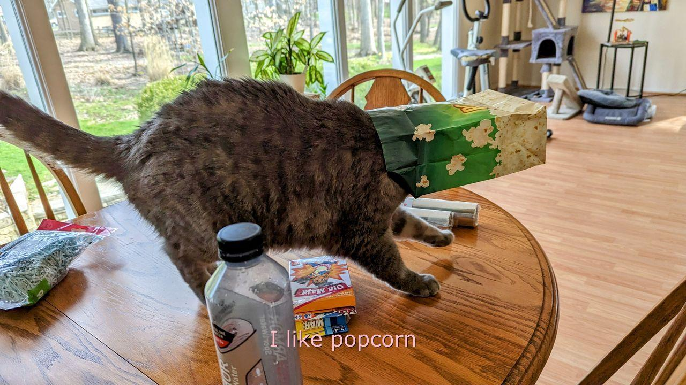

# Cat Image Retrieval Console Application :cat:
This is a Python console application which allows the user to retrieve an image from the [Cataas (Cat as a service) API ](https://cataas.com/) and save this image file locally to their system.

## Features 
* Select random image from API OR filter image selection with key-word tags
* Add text to image with customisation options: 
    * Text color options
    * Text size options
    * Font options
* Display image preview in dedicated window (e.g. opens Preview application in macOS)
* Save fetched image file with customisable location (directory and file name)
* Automatically save full record of all requests sent to the API in `.csv` file
    * Includes response.json() fields from API call: id, tags, created_at, url , mimetype (renamed as type)
    * Includes user-defined text options (used as parameters in API request): (text, fontColor, fontSize, font)

## Demo
### Terminal app demo


### Example output files 

Example output files (those generated from the recorded session) are found in the `app_records.example` and `images.example` directories

Example demo 'Random' file: 



Example file with 'gif' and 'cute' tags:


## Setup information
**Dependencies** 
* Local python installation - tested on `Python 3.12.2`
* Terminal application

**How to run**

A python virtual environment is used for ease of setup. 

The application can be set up and ran as follows:
```
python -m venv myenv 
source myenv/bin/activate
pip install -r requirements.txt
python app.py
``` 

**File formatting**

The *.py files included are formatted and linted using [black](https://black.readthedocs.io/en/stable/index.html#) and [ruff](https://docs.astral.sh/ruff/) respectively. (This is done using the dedicated VSCode extensions.)